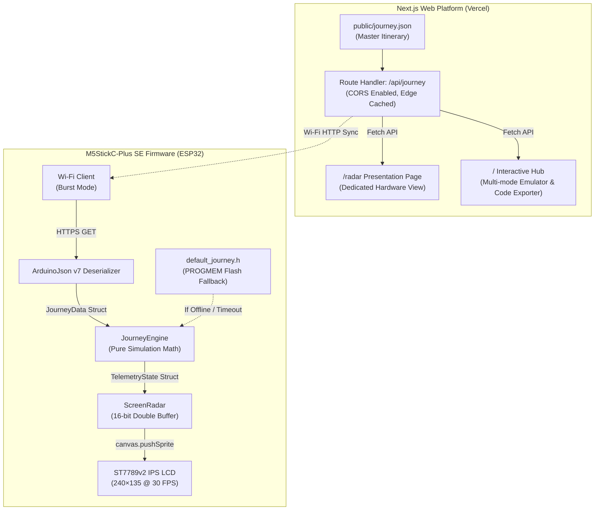
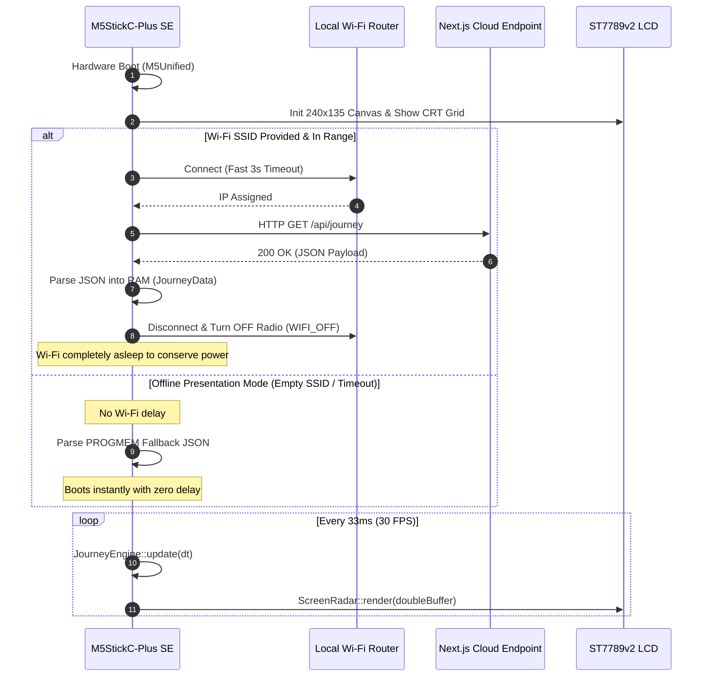

# Technical Architecture Specification: SANTA-OS

This document details the software engineering architecture, data pipelines, hardware abstraction, and testing strategies for **SANTA-OS**.

---

## 1. High-Level System Architecture

SANTA-OS employs a **dual-target, single-source-of-truth** architecture. Both the web application and embedded device share identical coordinate projections, simulation math, and route definitions.



---

## 2. Communication Scheme & Power Management

### The "Burst & Sleep" Battery Lifecycle
The M5StickC-Plus SE contains a 120mAh LiPo battery. Continuous Wi-Fi radio usage draws ~150mA, exhausting the battery in ~45 minutes. With the radio powered down, CPU and display draw ~40mA, achieving 2.5 to 3 hours of battery life.

To balance cloud sync with battery longevity, the firmware uses a **Burst & Sleep** lifecycle:



---

## 3. Firmware Modular Architecture

The C++ codebase adheres to strict separation of concerns, decoupling hardware interfaces, business logic, networking, and rendering:

```
firmware/
├── platformio.ini           # Build flags, 3MB huge_app partition, dependencies
├── include/
│   ├── config.h             # Pinouts, screen bounds, network timeouts, URLs
│   ├── types.h              # Platform-agnostic structs (Waypoint, JourneyData, TelemetryState)
│   ├── land_dots.h          # 912 precomputed PROGMEM coastline coordinates
│   └── default_journey.h    # Embedded fallback JSON string in PROGMEM
└── src/
    ├── core/
    │   ├── journey_engine.h # Pure math simulation (no display/hardware dependencies)
    │   └── journey_engine.cpp
    ├── network/
    │   ├── journey_client.h # Wi-Fi connection, HTTPClient & ArduinoJson parser
    │   └── journey_client.cpp
    ├── ui/
    │   ├── screen_radar.h   # Concentric rings, sweep beam, beacon, and HUD
    │   └── screen_radar.cpp
    └── main.cpp             # Hardware lifecycle (M5Unified) and frame dispatch
```

### Module Responsibilities:

| Module | Responsibility | Hardware Bound? | Unit Testable on Mac? |
| :--- | :--- | :--- | :--- |
| **`types.h`** | Data model definitions with conditional stdint/math includes | No | Yes |
| **`JourneyEngine`** | Coordinate projection, ease-in-out flight interpolation, ETA, speed multipliers | No | **Yes (0.55s native test)** |
| **`JourneyClient`** | Wi-Fi connection, HTTPClient, ArduinoJson deserialization, offline fallback | Only in fetch | **Yes (parseJson is tested)** |
| **`ScreenRadar`** | 16-bit double buffer rendering, dot-matrix world map, sweep beam, CRT HUD | Yes (`M5Canvas`) | No (Render layer) |
| **`main.cpp`** | Hardware init, button event polling, frame rate timing | Yes (`M5Unified`) | No (Entrypoint) |

---

## 4. Single Source of Truth: Journey JSON Schema

The shared contract between the cloud API and the embedded client:

```json
{
  "version": 1,
  "updatedAt": "2026-10-27T18:00:00Z",
  "secPerCity": 16,
  "speedMultiplier": 1,
  "route": [
    { "name": "AUCKLAND",    "lon": 174.8,  "lat": -36.8 },
    { "name": "SYDNEY",      "lon": 151.2,  "lat": -33.9 },
    { "name": "TOKYO",       "lon": 139.7,  "lat": 35.7 },
    { "name": "BEIJING",     "lon": 116.4,  "lat": 39.9 },
    { "name": "DELHI",        "lon": 77.2,   "lat": 28.6 },
    { "name": "DUBAI",        "lon": 55.3,   "lat": 25.2 },
    { "name": "NAIROBI",      "lon": 36.8,   "lat": -1.3 },
    { "name": "CAIRO",        "lon": 31.2,   "lat": 30.0 },
    { "name": "KRAKOW",       "lon": 19.9,   "lat": 50.1 },
    { "name": "LONDON",       "lon": -0.1,   "lat": 51.5 },
    { "name": "RIO",         "lon": -43.2,  "lat": -22.9 },
    { "name": "NEW YORK",    "lon": -74.0,  "lat": 40.7 },
    { "name": "MEXICO CITY", "lon": -99.1,  "lat": 19.4 },
    { "name": "LOS ANGELES", -118.2,        "lat": 34.0 },
    { "name": "HONOLULU",    -157.8,        "lat": 21.3 }
  ]
}
```

---

## 5. Testing & Verification Strategy

### 1. Desktop Native Unit Testing (`pio test -e native`)
By keeping `JourneyEngine` free from Arduino and display headers, the entire simulation engine is compiled and executed directly on desktop macOS/Linux via `clang`/`gcc` with the **Unity test framework**:

* **Tests Covered:**
  * `test_default_journey_parsing`: Verifies JSON deserialization and bounds.
  * `test_coordinate_projection`: Ensures Equirectangular lat/lon math maps accurately to the 240×135 viewport.
  * `test_journey_progression_and_interpolation`: Verifies ease-in-out interpolation curves between cities.
  * `test_speed_multiplier_cycle`: Validates state transitions (`1x` → `2x` → `4x` → `8x` → `1x`).
  * `test_jump_to_next_city`: Ensures Button A jump logic increments waypoints reliably.
  * `test_global_wraparound`: Verifies no out-of-bounds memory accesses when the route loops from Honolulu back to Auckland.

### 2. Automated GitHub Actions CI (`.github/workflows/ci.yml`)
Every commit pushed to GitHub automatically runs:
1. **Web Build:** Installs npm dependencies and verifies Next.js App Router build with zero TypeScript or lint errors.
2. **Firmware Desktop Tests:** Runs `pio test -e native` on Ubuntu runners.
3. **Firmware Hardware Compilation:** Runs `pio run -e m5stick-c` verifying flash size within the 3MB partition limit.
