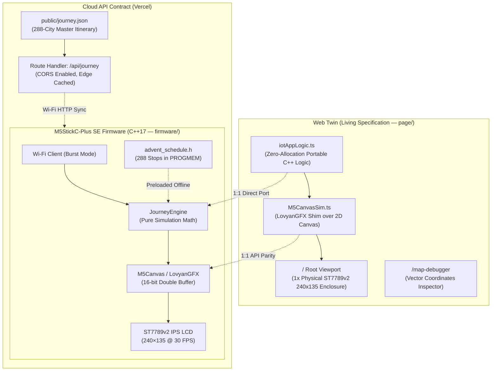
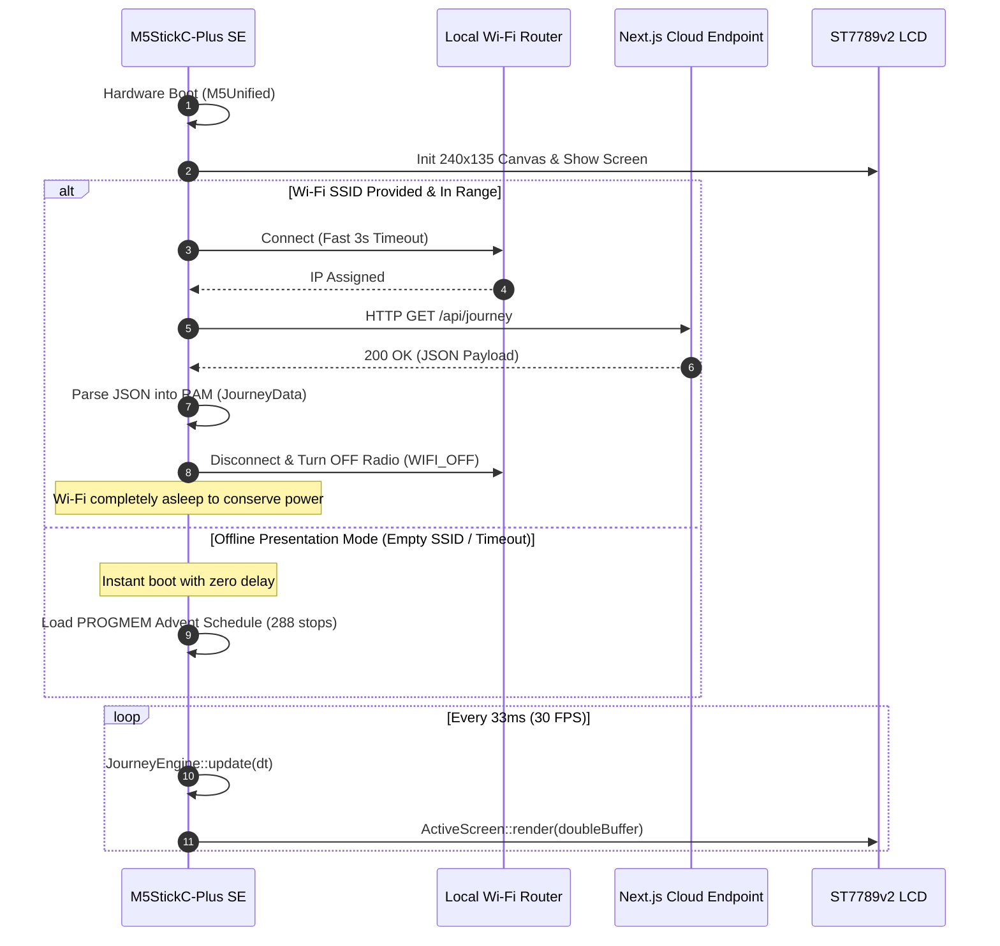

# Technical Architecture Specification: SANTA-OS

This document details the software engineering architecture, data pipelines, hardware abstraction, and testing strategies for **SANTA-OS**.

---

## 1. High-Level System Architecture (Twin-Engine Architecture)

SANTA-OS employs a **twin-engine, single-source-of-truth** architecture. The web application (`page/`) serves as the living, pixel-accurate hardware emulator and behavioral specification for the physical M5StickC-Plus SE IoT firmware (`firmware/`).



---

## 2. Web <-> IoT 1:1 Parity Mapping

To eliminate bugs and compilation cycle delays on physical hardware, every firmware subsystem has a corresponding 1:1 TypeScript module with matching API signatures, memory constraints, and coordinate math:

| Subsystem | Web Living Spec (`page/lib/simulator/`) | Firmware C++ Implementation (`firmware/`) | Parity Standard |
| :--- | :--- | :--- | :--- |
| **Graphics API** | `M5CanvasSim.ts` | `M5Canvas` (`LovyanGFX`) | Exact 1:1 method signatures (`fillRect`, `drawFastHLine`, `setTextDatum`, etc.), integer coordinate truncation (`Math.floor`) |
| **Color Math** | `M5Constants.ts` | 16-bit RGB565 (`color565()`) | Exact RGB565 packing and CSS color translation |
| **Simulation Kernel** | `iotAppLogic.ts` (`JourneyEngine`) | `core/journey_engine.cpp` | Identical easing curve (`easeInOut`), $O(1)$ time wrapping, and Kraków finale lock |
| **Screen 1: Radar** | `renderRadarScreen()` in `iotAppLogic.ts` | `ui/screen_radar.cpp` | CRT phosphor palette, 360° sweep ray, pulsing red beacon, 912-dot land matrix |
| **Screen 2: Cockpit**| `renderCockpitScreen()` in `iotAppLogic.ts` | `ui/screen_cockpit.cpp` (Active) | Modern full-color glass cockpit, Mach gauge, pixel-art sustenance icons |
| **Coastline Matrix** | `landDots.ts` (912 coordinates) | `land_dots.h` (PROGMEM) | Byte-for-byte identical dot coordinates |
| **Advent Schedule**  | `advent-schedule.ts` (288 stops) | `advent_schedule.h` (PROGMEM) | Exact 24-day itinerary, windows, and geographical coordinates |

---

## 3. Communication Scheme & Power Management

### The "Burst & Sleep" Battery Lifecycle
The M5StickC-Plus SE contains a 120mAh LiPo battery. Continuous Wi-Fi radio usage draws ~150mA, exhausting the battery in ~45 minutes. With the radio powered down, CPU and display draw ~40mA, achieving 2.5 to 3 hours of battery life.

To balance cloud sync with battery longevity, the firmware uses a **Burst & Sleep** lifecycle:



---

## 3. Firmware Modular Architecture

The C++ codebase adheres to strict separation of concerns, decoupling hardware interfaces, business logic, networking, and rendering:

```
firmware/
├── platformio.ini           # Build flags, 3MB huge_app partition, dependencies
├── include/
│   ├── config.h             # Pinouts, screen bounds, network timeouts, URLs
│   ├── types.h              # Platform-agnostic structs (Waypoint, JourneyData, TelemetryState)
│   ├── land_dots.h          # 912 precomputed PROGMEM coastline coordinates
│   ├── advent_schedule.h    # Preloaded 24-day itinerary (288 stops in PROGMEM)
│   └── default_journey.h    # Day 24 Grand Finale offline fallback JSON in PROGMEM
└── src/
    ├── core/
    │   ├── journey_engine.h # Pure math simulation (no display/hardware dependencies)
    │   └── journey_engine.cpp
    ├── network/
    │   ├── journey_client.h # Wi-Fi connection, HTTPClient & ArduinoJson parser
    │   └── journey_client.cpp
    ├── ui/
    │   ├── screen_radar.h   # Concentric rings, sweep beam, beacon, and HUD
    │   └── screen_radar.cpp
    └── main.cpp             # Hardware lifecycle (M5Unified) and frame dispatch
```

### Module Responsibilities:

| Module | Responsibility | Hardware Bound? | Unit Testable on Mac? |
| :--- | :--- | :--- | :--- |
| **`types.h`** | Data model definitions with conditional stdint/math includes | No | Yes |
| **`advent_schedule.h`** | 288 stops (24 days x 12 stops) compiled in PROGMEM (Flash ROM) | No | Yes |
| **`JourneyEngine`** | Coordinate projection, ease-in-out flight interpolation, ETA, day/city cycling, Kraków lock | No | **Yes (0.76s native test)** |
| **`JourneyClient`** | Wi-Fi connection, HTTPClient, ArduinoJson deserialization, offline fallback | Only in fetch | **Yes (parseJson is tested)** |
| **`ScreenRadar`** | 16-bit double buffer rendering, dot-matrix world map, sweep beam, CRT HUD | Yes (`M5Canvas`) | No (Render layer) |
| **`main.cpp`** | Hardware init, button event polling (Btn A: Day, Btn B: City), audio chirps | Yes (`M5Unified`) | No (Entrypoint) |

---

## 4. Single Source of Truth: Journey JSON Schema

The shared contract between the cloud API and the embedded client:

```json
{
  "version": 2,
  "updatedAt": "2026-10-29T18:00:00Z",
  "activeDay": 24,
  "secPerCity": 12,
  "speedMultiplier": 1,
  "route": [
    { "name": "GISBORNE",          "lon": 178.0176, "lat": -38.6623 },
    { "name": "BETHLEHEM",         "lon": 35.2024,  "lat": 31.7054 },
    { "name": "NIKOZJA",           "lon": 33.3667,  "lat": 35.1667 },
    { "name": "CHARTUM",           "lon": 32.5599,  "lat": 15.5007 },
    { "name": "NOUAKCHOTT",        "lon": -15.9785, "lat": 18.0735 },
    { "name": "CAYENNE",           "lon": -52.3135, "lat": 4.9224 },
    { "name": "WYSPA WIELKANOCNA", "lon": -109.4324,"lat": -27.1492 },
    { "name": "KIRITIMATI",        "lon": -157.4278,"lat": 1.8721 },
    { "name": "HONOLULU",          "lon": -157.8583,"lat": 21.3069 },
    { "name": "NUUK",              "lon": -51.6941, "lat": 64.1814 },
    { "name": "BIEGUN POLNOCNY",   "lon": 0.0000,   "lat": 90.0000 },
    { "name": "KRAKOW",            "lon": 19.9450,  "lat": 50.0647 }
  ]
}
```

---

## 5. Testing & Verification Strategy

### 1. Desktop Native Unit Testing (`pio test -e native`)
By keeping `JourneyEngine` free from Arduino and display headers, the entire simulation engine is compiled and executed directly on desktop macOS/Linux via `clang`/`gcc` with the **Unity test framework** (12/12 tests in 0.76s):

* **Tests Covered:**
  * `test_default_journey_parsing`: Verifies JSON deserialization and bounds for Day 24 fallback.
  * `test_advent_schedule_integrity`: Verifies all 288 stops across 24 days in PROGMEM with geographic bounds.
  * `test_coordinate_projection`: Ensures Equirectangular lat/lon math maps accurately to the 240×135 viewport.
  * `test_day_cycling_btn_a`: Validates Button A day cycling ($1 \rightarrow 24 \rightarrow 1$) and landed phase initialization.
  * `test_city_jumping_btn_b`: Ensures Button B city jump logic cycles all 12 stops reliably.
  * `test_day24_krakow_grand_finale_lock`: Validates Kraków arrival state (`isDay24Finale == true`, `eta == 0`) and 16-second celebration hold.
  * `test_trajectory_ease_interpolation`: Mathematically verifies the `easeInOut` curve and halfway midpoint accuracy.
  * `test_eta_countdown_progression`: Validates ETA countdowns across flight and landed phases.
  * `test_normal_day_looping_without_hold`: Verifies Days 1–23 loop cleanly at $144.0\text{s}$ without hold.
  * `test_day_switch_state_isolation`: Verifies switching away from Kraków lock resets state cleanly.
  * `test_long_duration_stability`: Simulates 24 continuous hours ($86,400\text{s}$) with $O(1)$ `fmodf` time wrapping and zero floating drift.
  * `test_malformed_json_resilience`: Fuzz-tests against null, empty, corrupt JSON, string overflow, and array clamping.

### 2. Automated GitHub Actions CI (`.github/workflows/ci.yml`)
Every commit pushed to GitHub automatically runs:
1. **Web Build & Test:** Runs `npm --prefix page test` verifying typecheck and 288-stop schedule tests with zero errors.
2. **Firmware Desktop Tests:** Runs `pio test -e native` on Ubuntu runners.
3. **Firmware Hardware Compilation:** Runs `pio run -e m5stick-c` verifying SRAM < 25% and flash size within the 3MB partition limit.
