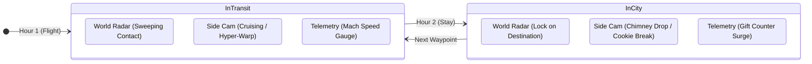

# SANTA-OS Master Development Roadmap

**Mission:** A 24-day Advent journey (Dec 1 – Dec 24) where Santa visits >200 cities across all continents, spending ~1 hour in transit and ~1 hour delivering gifts, synchronized across a custom M5StickC-Plus SE gadget and a companion web experience.

---

## Master Architecture & Rhythm

```
December 01 ───────────────────────────────────────────────────► December 24 (Grand Finale)
├── Cadence: ~1 hour FLIGHT  +  ~1 hour CITY STAY = 2 hours per waypoint
├── Throughput: 12 cities / day across all continents
└── Total Itinerary: 288 worldwide cities (>200 global waypoints)
```



---

## Phase 1: Pure Radar MVP (COMPLETE ✅)

* [x] **Subproject Segregation:** Isolated `firmware/` (PlatformIO, C++17) and `page/` (Next.js 15).
* [x] **M5StickC-Plus SE Hardware Calibration:** 240×135 ST7789v2 IPS double-buffered rendering, 3MB `huge_app` flash partition.
* [x] **Retro Radar Engine:**
  * 912 precomputed PROGMEM coastline dots.
  * Fixed-center 360° rotating radar sweep line with trailing ray.
  * Red/white flashing Santa contact blip with expanding radar ping rings.
  * Golden dotted breadcrumb flight trail.
* [x] **Single Source of Truth:** Shared JSON schema exposed at `/api/journey` and `public/journey.json`.
* [x] **Offline Resilience & Battery Conservation:** Instant boot with embedded PROGMEM demo data; "Burst & Sleep" Wi-Fi mode.
* [x] **Native Desktop Testing:** PlatformIO native test suite passing in under 1 second without hardware flashing.
* [x] **Clean Web Deployment:** Live on Vercel ([https://santa-tracker-five.vercel.app/](https://santa-tracker-five.vercel.app/)) with 1:1 hardware simulation.

---

## Phase 2: The 24-Day Master Itinerary & Live Clock Engine

* **Objective:** Expand route to 288 cities (>200) spanning Dec 1 – Dec 24, with context-aware timing (1h flight + 1h city stay).
* **Key Deliverables:**
  - [ ] **288-City Master Route Generation:**
    - Curate a geo-balanced itinerary spanning all 7 continents evenly across all 24 days.
    - Expose via `/api/journey` and `journey.json` (~10–14 KB payload, ~9.2 KB ESP32 RAM).
  - [ ] **Dual Clock Simulation Engine (`journey_engine`):**
    - **Live Advent Mode:** Reads RTC time (BM8563 / NTP) and matches the exact city for the current date & hour (Dec 1–24).
    - **Interactive Demo Mode:** Allows manual speed acceleration (`1x`, `2x`, `4x`, `8x`) and city jumping for testing outside December.
  - [ ] **State Transitions:**
    - Flag `isFlightPhase`: `true` for first 60 minutes, `false` for next 60 minutes.
    - Scaled progress interpolation and dynamic ETA countdowns to arrival/departure.

---

## Phase 3: Context-Aware Multi-Screen Expansion

* **Objective:** Port Side-View Santa Cam and Telemetry Dashboard, visually coupled to Santa's active state.
* **Key Deliverables:**
  - [ ] **Context-Aware Side-View Santa Cam (`ui/screen_cam.cpp`):**
    * **During Transit (Flight Hour):**
      - Mode A: *Cruising Sky* — Rudolph & sleigh bobbing through parallax snowfall and pine trees.
      - Mode B: *Hyper-Warp* — Star streaks, sleigh shake, glowing red Rudolph aura.
    * **During City Stay (Gift Drop Hour):**
      - Mode C: *Chimney Drop* — Parachuting gift boxes onto scrolling rooftops.
      - Mode D: *Cookie & Milk Break* — Santa eating cookies with animated munch counter.
  - [ ] **Santa's Telemetry Dashboard (`ui/screen_dash.cpp`):**
    - Live distance traveled (`KM`).
    - Sleigh speed (`MACH` during flight, `0.0` during roof landing).
    - Gifts delivered counter (ticks up during city stay).
    - Next destination banner.
  - [ ] **Hardware UI Cycling:**
    - Button A short-press cycles: `World Radar` (Hero) → `Santa Cam` → `Telemetry Dashboard`.

---

## Phase 4: Parent Customization & Wi-Fi Management

* **Objective:** Enable parents to customize Santa's December 24th route (e.g. inject their hometown) and configure Wi-Fi.
* **Key Deliverables:**
  - [ ] **Hometown Override in Itinerary:**
    - Cloud API allows custom hometown injection for Dec 24 bedtime window.
    - Santa's radar and ETA lock on the child's home city as the grand finale before returning to the North Pole.
  - [ ] **Smart Wi-Fi Sync:**
    - Device periodically connects (e.g. once every 24h or on boot) to refresh the journey schedule via `/api/journey`.
    - Shuts down Wi-Fi radio immediately after sync to preserve the 120mAh battery.
  - [ ] **Fallback & Offline Safety:**
    - Full 288-city schedule embedded in flash memory; works 100% offline if no Wi-Fi is configured.
  - [ ] **Optional Captive Setup Portal:**
    - If Wi-Fi fails, device can spawn a temporary AP (`Santa-Setup`) allowing parents to enter credentials via phone.

---

## Phase 5: Hardware Polish & Festive Packaging

* **Objective:** Package the gadget into an heirloom Christmas Eve maker toy.
* **Key Deliverables:**
  - [ ] **3D-Printed Sleigh/Chimney Dock:** Snap-on display dock with USB-C power pass-through.
  - [ ] **Audio Jingle Engine:** Polyphonic 8-bit Christmas chimes on city arrival using `M5.Speaker`.
  - [ ] **Kid's Flight Manual:** Retro printable mission log card to track cities daily from Dec 1 to Dec 24.
