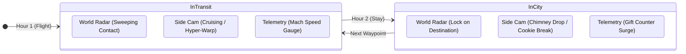

# SANTA-OS Master Development Roadmap

**Mission:** A 24-day Advent journey (Dec 1 – Dec 24) where Santa visits >200 cities across all continents, spending ~1 hour in transit and ~1 hour delivering gifts, synchronized across a custom M5StickC-Plus SE gadget and a companion web experience.

---

## Master Architecture & Rhythm

```
December 01 ───────────────────────────────────────────────────► December 24 (Grand Finale)
├── Cadence: ~1 hour FLIGHT  +  ~1 hour CITY STAY = 2 hours per waypoint
├── Throughput: 12 cities / day across all continents
└── Total Itinerary: 288 worldwide cities (>200 global waypoints)
```



---

## Phase 1: Pure Radar MVP (COMPLETE ✅)

* [x] **Subproject Segregation:** Isolated `firmware/` (PlatformIO, C++17) and `page/` (Next.js 15).
* [x] **M5StickC-Plus SE Hardware Calibration:** 240×135 ST7789v2 IPS double-buffered rendering, 3MB `huge_app` flash partition.
* [x] **Retro Radar Engine:**
  * 912 precomputed PROGMEM coastline dots.
  * Fixed-center 360° rotating radar sweep line with trailing ray.
  * Red/white flashing Santa contact blip with expanding radar ping rings.
  * Golden dotted breadcrumb flight trail.
* [x] **Single Source of Truth:** Shared JSON schema exposed at `/api/journey` and `public/journey.json`.
* [x] **Offline Resilience & Battery Conservation:** Instant boot with embedded PROGMEM demo data; "Burst & Sleep" Wi-Fi mode.
* [x] **Native Desktop Testing:** PlatformIO native test suite passing in under 1 second without hardware flashing.
* [x] **Clean Web Deployment:** Live on Vercel ([https://santa-tracker-five.vercel.app/](https://santa-tracker-five.vercel.app/)) with 1:1 hardware simulation.

---

## Milestone 1: Fully Operational Radar End-to-End (COMPLETE ✅)

* **Goal:** Deliver an end-to-end operational radar experience across Web and M5StickC hardware driven by the user's multi-day city dataset.
* **Requirements & Deliverables:**
  - [x] **1. User City List Ingestion:**
    * Ingest user's curated list of global cities spanning all continents across the Dec 1–24 calendar (`Harmonogram Santa Tracker 2026 - Harmonogram_Lotow.csv`).
    * Structured schema with 288 stops (12 stops/day) with coordinates, windows, and Santa's tasks.
  - [x] **2. Web Presentation & Testing Suite (`page/`):**
    * **Day Selector:** Interactive ribbon to select any day from **Dec 01 to Dec 24**, dynamically updating the radar route.
    * **10x / Warp Speed Testing Mode:** Dedicated test toggle to accelerate journey progression, enabling rapid verification.
    * **Coordinates Debugger (`/map-debugger`):** Interactive world map with great-circle trajectories and flight simulation.
  - [x] **3. Production JSON Endpoint (`/api/journey`):**
    * Exposes the full multi-day city list via `/api/journey` with edge caching and CORS.
    * Supports `?day=N` and `?mode=all` query parameters.
  - [x] **4. M5StickC-Plus SE Firmware (`firmware/`):**
    * Preloads all 24 days (288 stops) into flash ROM (`advent_schedule.h` in PROGMEM) with 0 bytes dynamic heap allocation.
    * Boots directly into December 24th Grand Finale route (culminating in Kraków, Poland at 22:00-23:00 UTC).
    * Physical buttons: Button A cycles days (1 $\rightarrow$ 24 $\rightarrow$ 1); Button B advances through cities on the active day.
    * 12 native desktop unit tests passing in 0.76s.

---

## Milestone 2: Context-Aware Multi-Screen Visual Experience (ACTIVE 🎯)

> [!NOTE]
> **Why Multi-Screen Before Real-Time Clock?**
> We are currently ~1 month before December. Connecting the hardware to the live real-time clock (NTP/RTC) now would freeze Santa until December 1st and prevent interactive visual development and testing. We remain on **simulated/demo clock mode** (`secPerCity = 12s`, Day & City button cycling) to build, animate, and evaluate all screens and states smoothly. Real-Time Clock progression will be delivered as the final milestone right before December.

* **Objective:** Deliver the 2 remaining core screens on the web companion emulator first, then port them to the M5StickC firmware with strict 1:1 parity and zero dynamic heap allocation.
* **Sequential Delivery Rule:** **Web Companion App First (`page/`), Firmware Second (`firmware/`)**.
* **Key Deliverables:**
  - [x] **Screen 2: Cockpit Dashboard (`ui/screen_cockpit`) (COMPLETE ✅):**
    * [x] **Web Living Specification:** 1:1 `renderCockpitScreen()` in `iotAppLogic.ts` with modern aerospace glass cockpit palette, multi-color Mach 4.8 gauge, demographic gift distribution, pixel-art cookies & milk, and dynamic tactical mission phase box.
    * [x] **C++ Firmware Port (`firmware/src/ui/screen_cockpit.cpp`):** Direct zero-heap port to LovyanGFX for ST7789v2 IPS display with 16 native Unity tests passing in 1.8s.
  - [ ] **Screen 3: Side-View Santa Cam (`ui/screen_cam`) (NEXT 🎯):**
    * **During Transit (Flight Phase):**
      - Mode A: *Cruising Sky* — Rudolph & sleigh bobbing through parallax starry skies, falling snowflakes, and silhouetted mountain pines.
      - Mode B: *Hyper-Warp* — Hyperspace star streaks, sleigh shake, glowing red Rudolph nose aura when speed accelerates.
    * **During City Stay (Landed Gift Drop Phase):**
      - Mode C: *Chimney Drop* — Parachuting wrapped gift boxes onto scrolling cozy rooftop chimneys.
      - Mode D: *Cookie & Milk Break* — Santa eating cookies next to a fireplace with an animated cookie munch counter.
  - [x] **Screen Cycling & Navigation:**
    * [x] Carousel cycling on Button A: `Screen 1 (Radar)` $\leftrightarrow$ `Screen 2 (Cockpit)`.
    * [x] Hardware button parity (Button A: Screen Toggle, Button B: City Advance, Button B Hold: Sound Chirp Mute).

---

## Milestone 3: Parent Customization & Wi-Fi Management

* **Objective:** Enable parents to customize Santa's December 24th route (e.g. inject their hometown) and configure Wi-Fi.
* **Key Deliverables:**
  - [ ] **Hometown Override in Itinerary:**
    - Cloud API allows custom hometown injection for Dec 24 bedtime window.
    - Santa's radar and ETA lock on the child's home city as the grand finale before returning to the North Pole.
  - [ ] **Smart Wi-Fi Sync ("Burst & Sleep"):**
    - Device periodically connects (e.g. once every 24h or on boot) to refresh the journey schedule via `/api/journey`.
    - Shuts down Wi-Fi radio immediately after sync to preserve the 120mAh battery.
  - [ ] **Fallback & Offline Safety:**
    - Full 288-city schedule embedded in flash memory; works 100% offline if no Wi-Fi is configured.
  - [ ] **Optional Captive Setup Portal:**
    - If Wi-Fi fails, device can spawn a temporary AP (`Santa-Setup`) allowing parents to enter credentials via phone.

---

## Milestone 4: Hardware Polish & Festive Packaging

* **Objective:** Package the gadget into an heirloom Christmas Eve maker toy.
* **Key Deliverables:**
  - [ ] **3D-Printed Sleigh/Chimney Dock:** Snap-on display dock with USB-C power pass-through.
  - [ ] **Audio Jingle Engine:** Polyphonic 8-bit Christmas chimes on city arrival using `M5.Speaker`.
  - [ ] **Kid's Flight Manual:** Retro printable mission log card to track cities daily from Dec 1 to Dec 24.

---

## Milestone 5: Live Real-Time Clock & Advent Launch (THE FINAL PRE-DECEMBER MILESTONE 🎄)

* **Objective:** Transition the firmware and web platform from simulated/demo time to the live 24-day Advent calendar clock (Dec 1 – Dec 24) using ESP32 RTC (BM8563) and NTP synchronization.
* **Key Deliverables:**
  - [ ] **Dual Clock Engine (`journey_engine`):**
    - **Live Advent Mode (Production):**
      - Synchronized to real-world RTC/NTP time.
      - Matches exact day (Dec 1–24) and exact 2-hour window (1h flight + 1h city stay).
    - **Interactive Demo Override Mode (Preserved):**
      - Dedicated hardware button hold during boot or web toggle allowing parents and kids to simulate any day/city anytime outside of December.
  - [ ] **Pre-Advent Countdown Screen (Pre-December 1st):**
    - If powered on before Dec 1st, displays a festive "North Pole Workshop — Sleigh Pre-Flight Prep" countdown until launch.
  - [ ] **State Transition Cadence:**
    - Exact 60-minute in-flight phase + 60-minute landed city phase.
    - Day 24 22:00-23:00 UTC Kraków Grand Finale arrival lock.
