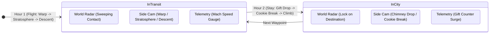

# SANTA-OS Master Development Roadmap

**Mission:** A 24-day Advent journey (Dec 1 – Dec 24) where Santa visits 288 stops across all continents, spending ~1 hour in transit and ~1 hour delivering gifts, synchronized across a custom M5StickC-Plus SE gadget and a companion web experience.

> [!NOTE]
> This roadmap tracks macro milestone progression and high-level deliverables. Active milestone execution is planned interactively via `/plan` and verified through automated quality gates.

---

## Master Architecture & Rhythm

```
December 01 ───────────────────────────────────────────────────► December 24 (Grand Finale)
├── Cadence (Real Advent Mode): 1 hour FLIGHT + 1 hour CITY STAY = 2 hours per stop
├── Throughput: 12 cities / day across all continents
├── Cadence (Demo Preview Mode): 15s FLIGHT + 15s CITY STAY = 30s per stop
└── Total Itinerary: 288 worldwide cities preloaded in ROM (PROGMEM)
```



---

## Phase 1: Pure Radar MVP (COMPLETE ✅)

* [x] **Subproject Segregation:** Isolated `firmware/` (PlatformIO, C++17) and `page/` (Next.js 15).
* [x] **M5StickC-Plus SE Hardware Calibration:** 240×135 ST7789v2 IPS double-buffered rendering, 3MB `huge_app` flash partition.
* [x] **Retro Radar Engine:**
  * 912 precomputed PROGMEM coastline dots.
  * Fixed-center 360° rotating radar sweep line with trailing ray.
  * Red/white flashing Santa contact blip with expanding radar ping rings.
  * Golden dotted breadcrumb flight trail.
* [x] **Single Source of Truth:** Shared JSON schema exposed at `/api/journey` and `public/journey.json`.
* [x] **Offline Resilience & Battery Conservation:** Instant boot with embedded PROGMEM demo data.
* [x] **Native Desktop Testing:** PlatformIO native test suite passing in under 1 second without hardware flashing.
* [x] **Clean Web Deployment:** Live on Vercel ([https://santa-tracker-five.vercel.app/](https://santa-tracker-five.vercel.app/)) with 1:1 hardware simulation.

---

## Milestone 1: Fully Operational Radar End-to-End (COMPLETE ✅)

* **Goal:** Deliver an end-to-end operational radar experience across Web and M5StickC hardware driven by the user's multi-day city dataset.
* **Requirements & Deliverables:**
  - [x] **1. User City List Ingestion:**
    * Ingest user's curated list of global cities spanning all continents across the Dec 1–24 calendar (`Harmonogram Santa Tracker 2026 - Harmonogram_Lotow.csv`).
    * Structured schema with 288 stops (12 stops/day) with coordinates, windows, and Santa's tasks.
  - [x] **2. Web Presentation & Testing Suite (`page/`):**
    * **Day Selector:** Interactive ribbon to select any day from **Dec 01 to Dec 24**, dynamically updating the radar route.
    * **10x / Warp Speed Testing Mode:** Dedicated test toggle to accelerate journey progression, enabling rapid verification.
    * **Coordinates Debugger (`/map-debugger`):** Interactive world map with great-circle trajectories and flight simulation.
  - [x] **3. Production JSON Endpoint (`/api/journey`):**
    * Exposes the full multi-day city list via `/api/journey` with edge caching and CORS.
    * Supports `?day=N` and `?mode=all` query parameters.
  - [x] **4. M5StickC-Plus SE Firmware (`firmware/`):**
    * Preloads all 24 days (288 stops) into flash ROM (`advent_schedule.h` in PROGMEM) with 0 bytes dynamic heap allocation.
    * Boots directly into December 24th Grand Finale route (culminating in Kraków, Poland at 22:00-23:00 UTC).
    * Physical buttons: Button A cycles days (1 $\rightarrow$ 24 $\rightarrow$ 1); Button B advances through cities on the active day.
    * 12 native desktop unit tests passing in 0.76s.

---

## Milestone 2: Context-Aware Multi-Screen Visual Experience (COMPLETE ✅)

* **Objective:** Deliver the 2 remaining core screens on the web companion emulator first, then port them to the M5StickC firmware with strict 1:1 parity and zero dynamic heap allocation.
* **Sequential Delivery Rule:** **Web Companion App First (`page/`), Firmware Second (`firmware/`)**.
* **Key Deliverables:**
  - [x] **Screen 2: Cockpit Dashboard (`ui/screen_cockpit`) (COMPLETE ✅):**
    * [x] **Web Living Specification:** 1:1 `renderCockpitScreen()` in `iotAppLogic.ts` with modern aerospace glass cockpit palette, multi-color Mach 4.8 gauge, demographic gift distribution, pixel-art cookies & milk, and dynamic tactical mission phase box.
    * [x] **C++ Firmware Port (`firmware/src/ui/screen_cockpit.cpp`):** Direct zero-heap port to LovyanGFX for ST7789v2 IPS display with 16 native Unity tests passing in 1.8s.
  - [x] **Screen 3: Side-View Santa Cam (`ui/screen_cam`) (COMPLETE ✅):**
    * [x] **Web Living Specification:** 1:1 `camScreen.ts` / `renderCamScreen()` in `iotAppLogic.ts` featuring 7 dynamic sub-phases matching the cadence:
      1. Hyper-Warp Mode (`TRYB HYPER-WARP`, 30% duration): Horizontal speed streaks, sleigh vibration, twin jet flames, Rudolph aura.
      2. Stratospheric Flight (`PRZELOT STRATOSFERYCZNY`, 50% duration): Curved Earth globe, glowing atmosphere, 48 cosmic stars, shooting star.
      3. Gliding Descent (`ZNIZANIE`, 20% duration): Sleigh descent toward snowy pine trees growing in perspective with twinkling fairy lights.
      4. Rooftop Gift Drop (`ZRZUT PREZENTOW`, 40% duration): Sleigh cruising over townhouses, parachuting presents landing in chimneys.
      5. Cookie & Milk Break (`PRZERWA NA CIASTKA I MLEKO`, 40% duration): Big Santa by the fireplace, dancing flames, cookies, milk & crumbs.
      6. Takeoff Climb (`WZNOSZENIE`, 20% duration): Takeoff climb into starry sky, trees shrinking in reverse perspective.
      7. Merry Christmas! (`WESOŁYCH ŚWIĄT!`, Kraków): Bazylika Mariacka spires silhouette, celebratory fireworks & banner.
    * [x] **Dedicated Scene Debugger Studio (`/scene-debugging`):** Interactive gallery with speed controls (0.25x–4x), manual scene isolation, and multi-cam matrix.
    * [x] **Single Source of Truth (`stage-definitions.ts`):** Canonical stage titles and story descriptions shared across web, cockpit, and C++ firmware.
    * [x] **C++ Firmware Port (`firmware/src/ui/screen_cam.cpp`):** Direct zero-heap port to LovyanGFX for ST7789v2 IPS display with 18 native Unity tests passing in 0.43s.
  - [x] **Screen Cycling & Navigation:**
    * [x] Circular 3-screen carousel on Button A: `Screen 1 (Radar)` $\rightarrow$ `Screen 2 (Cockpit)` $\rightarrow$ `Screen 3 (Santa Cam)` $\rightarrow$ `Screen 1`.
    * [x] Hardware button parity (Button A: Screen Toggle, Button B: City Advance, Button B Hold: Sound Chirp Mute).

---

## Milestone 3A: Pure Web Installer for IoT (Flashing & Packaging) (COMPLETE ✅)

## Milestone 3A: Pure Web Installer for IoT (Flashing & Packaging) (COMPLETE ✅)

* **Objective:** Enable parents and makers to flash Santa-OS onto physical M5StickC-Plus / Plus SE hardware directly from the Santa Tracker web application in under 60 seconds over USB using the Web Serial API and ESP Web Tools.
* **Core Technology:** Web Serial API (`navigator.serial`), **ESP Web Tools** (`esp-web-tools`), Next.js 15, and PlatformIO ESP32 toolchain.
* **Key Deliverables:**
  - [x] **1. Automated Firmware Packaging Pipeline (`scripts/package-firmware.mjs`):**
    * Compiles PlatformIO `m5stick-c` binary target (`pio run -e m5stick-c`).
    * Bundles `bootloader.bin` (0x1000), `partitions.bin` (0x8000), `boot_app0.bin` (0xe000), and `firmware.bin` (0x10000) into `page/public/firmware/`.
    * Dynamically extracts application version from `page/package.json`.
    * Generates `manifest.json` conforming to ESP Web Tools specification with MD5 checksum reporting.
  - [x] **2. Dedicated `/install` Web Route (`page/app/install/page.tsx`):**
    * Dedicated, festive installation hub with real-time browser capability detection (`checkWebSerialSupport()`).
    * Minimalist festive hero UI featuring a prominent install button and 3 feature highlight cards (MikoRadar, Kokpit Misji, Santa Cam).
    * Collapsible driver & troubleshooting guide with direct links for CP2104 (Silicon Labs) and CH9102 (WCH) USB-to-UART bridges.
    * Client-side dynamic Web Serial flasher button using `<esp-web-install-button>`.
  - [x] **3. Navigation Integration (`page/app/page.tsx`):**
    * Top navigation bar CTA: `⚡ Instalator M5Stick`.
    * Left-column hardware callout card under emulator inviting users to flash their real device.
  - [x] **4. Automated Quality & Specification Tests:**
    * `page/__tests__/web-installer.test.ts` verifying manifest schema, partition offsets, binary sizes, and browser detection matrix.

---

## Milestone 3B: In-Browser Wi-Fi Setup & NTP Provisioning (COMPLETE ✅)

* **Objective:** Enable parents and kids to configure Wi-Fi credentials in-browser via Improv Wi-Fi Serial immediately after flashing or upon reconnecting the device, persisting credentials to NVS and performing an initial NTP time sync with battery-backed RTC persistence.
* **Core Technology:** **Improv Wi-Fi Serial** protocol, ESP32 NVS (`Preferences`), SNTP time client, and BM8563 hardware RTC (`M5.Rtc`).
* **Key Deliverables:**
  - [x] **1. Firmware Improv Wi-Fi & NVS Handler (`firmware/src/network/improv_handler.cpp`):**
    * Lightweight Improv Wi-Fi Serial protocol listener handling RPC frames over UART (`Serial`).
    * Asynchronous, non-blocking connection with 8.0-second timeout: zero-delay instant boot on frame 1 without freezing display or simulation.
    * On receiving credentials: tests Wi-Fi connection, saves valid credentials to ESP32 Flash NVS (`Preferences` namespace `"santa_cfg"`), and reports device IP to the browser.
    * Initial SNTP time sync configuring Polish CET timezone (`CET-1CEST,M3.5.0,M10.5.0/3`).
    * Hardware BM8563 RTC persistence: writes UTC time to onboard battery-backed RTC chip (`M5.Rtc.setDateTime()`), automatically restored on boot (`M5.Rtc.setSystemTimeFromRtc()`).
    * "Burst & Sleep" power management: powers off Wi-Fi radio (`WiFi.mode(WIFI_OFF)`) ~5 seconds after sync or immediately upon timeout, reducing power consumption to ~40mA.
    * Top HUD status micro dot (`(6, 6)`) and contextual pop-up toasts (connected with live synchronized clock `CZAS NTP: HH:MM CET`, offline 2-line alert).
    * Retains 100% offline fallback: if no Wi-Fi is configured or network is unreachable, Santa-OS boots immediately using ROM data.
    * 7 new native desktop unit tests (Tests 19–25) verifying Improv framing, state machines, packet parsers, and burst-and-sleep cycles.
  - [x] **2. Web UI In-Browser Wi-Fi Flow (`page/`):**
    * Seamless post-flash transition: Once flashing completes, the ESP Web Tools dialog prompts for Wi-Fi SSID and password via Improv Wi-Fi Serial.
    * Dedicated returning-user management: Added `ImprovWifiButton.tsx` (`<improv-wifi-serial-launch-button>`) to `/install` allowing parents to reconfigure Wi-Fi or view serial logs on existing devices without reflashing.
    * Living specification parity: Implemented matching top-left status micro dot and pop-up toasts with live clock in `iotAppLogic.ts` and `camScreen.ts`.
    * Unit tests in `simulator.test.ts` and `web-installer.test.ts` validating UI elements, DOM elements, and status transitions.

---

## Milestone 4: Dual-Mode Journey Engine & RTC / NTP Time Synchronization (COMPLETE ✅)

* **Objective:** Transition the simulation engine to support two distinct operating modes: an interactive fast-paced Demo Mode, and a real-world live Advent Calendar Mode (Dec 1 – Dec 24) driven by the ESP32 hardware RTC (BM8563) and periodic NTP synchronization.
* **Key Deliverables:**
  - [x] **1. Web Living Specification for Dual Clock (`page/lib/simulator/`):**
    * Update `iotAppLogic.ts` and `useSimulationClock` to support `MODE_DEMO` vs `MODE_REAL`.
    * In `MODE_REAL`:
      - City schedule driven by real UTC/CET date & time.
      - 2-hour waypoint cadence: **1 hour in-flight transit** + **1 hour landed city dwell**.
      - Scale the sub-phase scenes proportionally (Warp 18m, Stratosphere 30m, Descent 12m; Gifts 24m, Cookies 24m, Climb 12m).
      - Off-season chilling mode (Mode 8) displayed when current date is outside Dec 01–24.
      - December 24th Kraków Grand Finale lock after 22:00-23:00 UTC.
    * Linear trajectory progress ($p = u / \text{flight}$) maintaining continuous movement.
    * Interactive time/date simulation presets (`Dzisiaj / Urlop`, `01 Gru`, `15 Gru`, `24 Gru`) on `/`.
    * Dedicated Scene Debugger Studio (`/scene-debugging`) expanded with Mode 8.
    * Automated unit test suite (`vitest`) with 62 unit tests passing (100%).
  - [x] **2. Firmware Hardware RTC & "Burst & Sleep" NTP Client (`firmware/`):**
    * Initialize onboard **BM8563 I2C RTC** via `M5.Rtc`.
    * "Burst & Sleep" NTP daemon:
      - Wakes Wi-Fi on boot and every 12–24h for a brief 2–4 second burst.
      - Fetches NTP time via `configTzTime()` and writes to BM8563 RTC (`M5.Rtc.setDateTime()`).
      - Immediately powers off Wi-Fi radio (`WiFi.mode(WIFI_OFF)`) to drop power to ~40mA and preserve battery.
  - [x] **3. Dual Journey Engine Port (`firmware/src/core/journey_engine.cpp`):**
    * Engine reads BM8563 hardware RTC in Real Advent Mode.
    * Deterministic mapping: Day of month (1..24) $\rightarrow$ Active Advent Day; Hour ($S \in [0..86400]$) $\rightarrow$ Waypoint ($\lfloor S / 7200 \rfloor$) and Phase ($u = S \pmod{7200}$).
    * Intelligent Mode Selection: Defaults to Real Mode if RTC/NTP date is December 1–24; otherwise launches Demo Mode.
    * Hardware Controls:
      - Hold Button PWR (>0.6s) rotates between Demo Mode and Real Advent Mode with audio chime and toast (Button B hold also supported as alternate).
      - Short click Button B advances city in Demo Mode (locked in Real-Time Mode).
      - Short click Button PWR toggles audio mute/unmute.
      - Short click Button A cycles screens; long hold Button A advances day in Demo Mode (locked in Real-Time Mode).
  - [x] **4. Desktop Native Unit Tests (`firmware/test/`):**
    * 29 Unity unit tests running under `pio test -e native` verifying RTC time decoding, 2-hour cadence boundaries, linear transit progression, off-season chilling mode, wall clock synchronization, and mode switches.

---

## Milestone 5: Festive IoT Landing Page & `/debugger` Separation (COMPLETE ✅)

* **Objective:** Present a focused, playful, Christmas-themed Santa Tracker IoT landing page at `/` with a single clear "Install" CTA (`/install`), while moving the full hardware workbench, simulator controls, and telemetry panels to `/debugger`.
* **Key Deliverables:**
  - [x] **1. Dedicated Landing Page (`page/app/page.tsx`):**
    * Designed from the ground up with `/impeccable` in the **Kurier Bieguna Północnego** warm gingerbread-cream paper aesthetic (`#fbf3e4`) with `FestivePaperBackdrop` Christmas motifs.
    * 100% Polish copy focused on tracking Santa's Advent journey, paired with an interactive 1:1 `M5StickDevice` preview defaulting to **Santa Cam** in **Real-Time Mode** (long-press `B` to toggle Demo Mode; click `M5` or screen tabs to cycle `MikoRadar`, `Kokpit Misji`, `Santa Cam`).
    * Single primary CTA (`Zainstaluj na M5Stick` $\rightarrow$ `/install`), with the `/debugger` link placed discreetly in `/install`'s footer.
  - [x] **2. Hardware Workbench Relocation (`page/app/debugger/page.tsx`):**
    * Moved the full 1:1 hardware simulator, 24-day Advent ribbon, simulation date presets, telemetry panels, and links to `/map-debugger` and `/scene-debugging` to `/debugger`.
    * Updated navigation links across `/map-debugger`, `/scene-debugging`, and `/install` for clean round-trip wayfinding.
