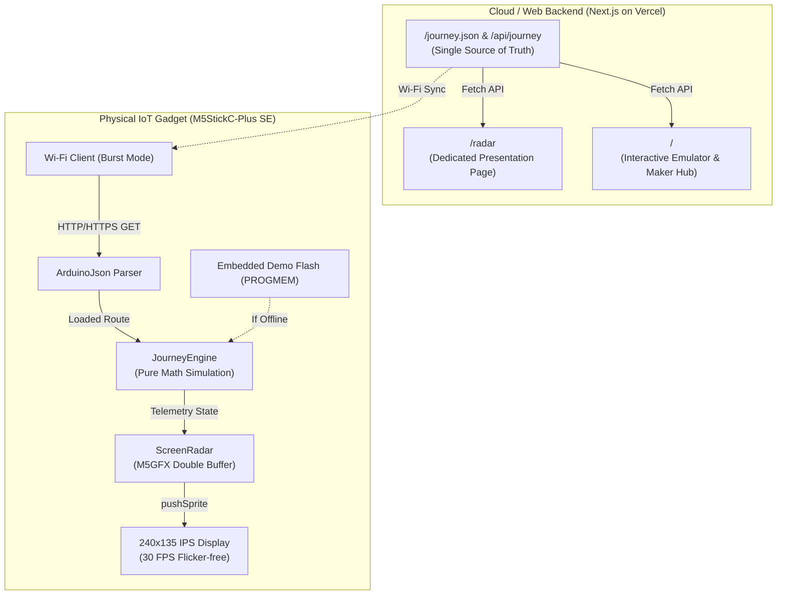
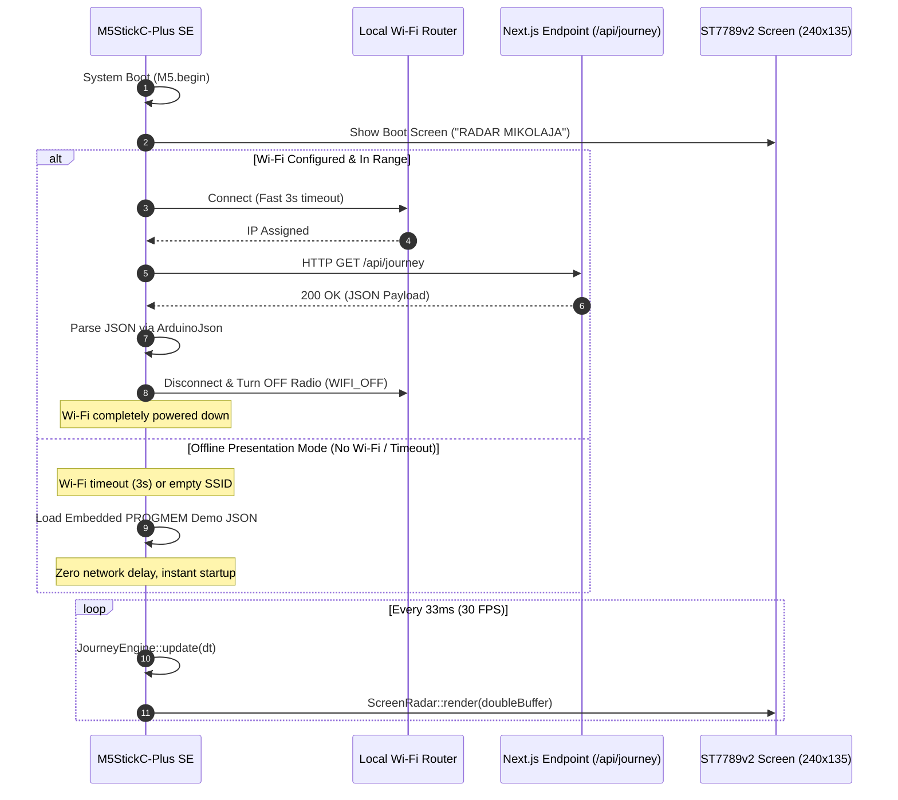

# SANTA-OS: Architecture, Communication Scheme & Roadmap

**Target Hardware:** M5StickC-Plus SE (ESP32-PICO-D4, 240×135 ST7789v2 IPS Display)  
**Companion App:** Next.js 15 (App Router, Tailwind CSS, TypeScript, Canvas API)  
**Status:** MVP Implemented & Verified

---

## 1. System Overview & Core Philosophy

The project unites two execution targets around a **single source of truth**:
1. **The Physical IoT Gadget (`firmware/`):** A pocket-sized, battery-powered retro aviation radar running C++17 on the ESP32.
2. **The Interactive Web Presentation (`page/`):** A pixel-accurate emulator and presentation suite accessible in any modern browser.

Both platforms consume the **same JSON journey schema**, use identical coordinate projection mathematics, and run the same radar simulation loop.



---

## 2. Communication Scheme & Resilience

### The "Burst & Sleep" Battery Strategy
The M5StickC-Plus SE includes an integrated **120mAh LiPo battery**. 
* Keeping the ESP32 Wi-Fi radio continuously powered draws ~120–160mA, depleting the battery in under 45 minutes.
* By turning Wi-Fi **OFF**, the system draws only ~35–45mA, achieving **2.5 to 3 hours** of continuous display life.

Therefore, the firmware uses a **Burst & Sleep** lifecycle:



---

## 3. Firmware C++ Modular Architecture

The firmware is structured to cleanly decouple hardware, business logic, networking, and rendering:

```
firmware/
├── platformio.ini           # Build flags, 3MB huge_app partition, dependencies
├── include/
│   ├── config.h             # Hardware constants, screen size, Wi-Fi credentials
│   ├── types.h              # Data structures: Waypoint, JourneyData, TelemetryState
│   ├── land_dots.h          # 912 precomputed PROGMEM coastline coordinates
│   └── default_journey.h    # Embedded fallback JSON string in PROGMEM
└── src/
    ├── core/
    │   ├── journey_engine.h # Pure math simulation (no display/hardware dependencies)
    │   └── journey_engine.cpp
    ├── network/
    │   ├── journey_client.h # Wi-Fi connection, HTTPClient & ArduinoJson parser
    │   └── journey_client.cpp
    ├── ui/
    │   ├── screen_radar.h   # Concentric rings, sweep beam, beacon, and HUD
    │   └── screen_radar.cpp
    └── main.cpp             # Hardware lifecycle (M5Unified) and frame dispatch
```

### Module Responsibilities:
1. **`JourneyEngine` (Core):**
   * Computes Santa's interpolated coordinates $(\text{lon}, \text{lat}) \to (x, y)$ using ease-in-out curves.
   * Calculates dynamic ETA countdown and current destination.
   * Handles user speed scaling (`1x`, `2x`, `4x`, `8x`) and waypoint jumping.
   * **Unit Testable:** Contains zero LCD or M5Stack code, allowing native Mac execution via `pio test -e native`.
2. **`JourneyClient` (Network):**
   * Fetches remote JSON from any HTTP/HTTPS endpoint.
   * Safely deserializes payload into typed C++ memory structs.
   * Powers down the Wi-Fi radio immediately after completion.
   * Instantly activates fallback data if network is missing.
3. **`ScreenRadar` (UI):**
   * Manages the 16-bit double buffer (`M5Canvas`).
   * Renders the 912 dot-matrix continents, fixed-center 360° rotating sweep beam, dotted breadcrumb trail, and retro green CRT HUD overlays.

---

## 4. Single Source of Truth: Journey JSON Schema

Both the Next.js API (`/api/journey`) and the embedded offline fallback share this schema:

```json
{
  "version": 1,
  "updatedAt": "2026-10-27T18:00:00Z",
  "secPerCity": 16,
  "speedMultiplier": 1,
  "route": [
    { "name": "AUCKLAND",    "lon": 174.8,  "lat": -36.8 },
    { "name": "SYDNEY",      "lon": 151.2,  "lat": -33.9 },
    { "name": "TOKYO",       "lon": 139.7,  "lat": 35.7 },
    { "name": "BEIJING",     "lon": 116.4,  "lat": 39.9 },
    { "name": "DELHI",        "lon": 77.2,   "lat": 28.6 },
    { "name": "DUBAI",        "lon": 55.3,   "lat": 25.2 },
    { "name": "NAIROBI",      "lon": 36.8,   "lat": -1.3 },
    { "name": "CAIRO",        "lon": 31.2,   "lat": 30.0 },
    { "name": "KRAKOW",       "lon": 19.9,   "lat": 50.1 },
    { "name": "LONDON",       "lon": -0.1,   "lat": 51.5 },
    { "name": "RIO",         "lon": -43.2,  "lat": -22.9 },
    { "name": "NEW YORK",    "lon": -74.0,  "lat": 40.7 },
    { "name": "MEXICO CITY", "lon": -99.1,  "lat": 19.4 },
    { "name": "LOS ANGELES", -118.2,        "lat": 34.0 },
    { "name": "HONOLULU",    -157.8,        "lat": 21.3 }
  ]
}
```

---

## 5. Comprehensive Project Roadmap

### Phase 1: MVP (Complete ✅)
* [x] **Project Reorganization:** Segregated codebase into `page/` (Next.js) and `firmware/` (PlatformIO).
* [x] **Hardware Calibration:** Configured ST7789v2 240×135 IPS display with `huge_app` partition table.
* [x] **Pixel-Accurate Radar:** 912 PROGMEM coastline dots, center-fixed rotating green radar beam, red traveling Santa contact blip, and golden dotted breadcrumb trail.
* [x] **Single Source of Truth:** `public/journey.json` and `/api/journey` with CORS.
* [x] **Dedicated Presentation View:** `/radar` web presentation running the exact simulation.
* [x] **Offline Fallback:** Instant boot to preloaded demo route when Wi-Fi is disabled or out of range.
* [x] **Interactive Controls:** Button A (Jump to city), Button B (Cycle speed `1x`–`8x`), Hold Button B (Audio mute).

---

### Phase 2: Live Clock Sync (Christmas Eve Countdown)
* [ ] **NTP Synchronization:** Sync onboard RTC (BM8563) via Network Time Protocol when Wi-Fi is briefly connected.
* [ ] **December 24th Progression:** Scale Santa's position dynamically based on real UTC wall-clock time between 12:00 UTC (Dec 24) and 06:00 UTC (Dec 25).
* [ ] **Waiting Mode (Pre-flight):** Before Dec 24, show Santa at North Pole preparing sleigh with countdown timer.

---

### Phase 3: Parent Configuration Portal
* [ ] **Custom Destination:** Allow parents to input their home city name, coordinates, and bedtime target.
* [ ] **Captive Wi-Fi Portal (ESP32-AP):** If device cannot connect to Wi-Fi, spawn an access point (`Santa-Setup`) allowing parents to enter home Wi-Fi credentials from their smartphone without recompiling firmware.
* [ ] **NVS / LittleFS Storage:** Store configured city and Wi-Fi credentials in persistent flash memory.

---

### Phase 4: Full Multi-Screen Experience
* [ ] **Screen 1 (Side Santa Cam):** Port 4-step pixel animations (Flying sleigh, Chimney drop, Cookie break, Hyper-warp) from prototype into `ui/screen_cam.cpp`.
* [ ] **Screen 2 (Telemetry Dashboard):** Port Mach speed meter, real-time gifts counter, and distance gauge into `ui/screen_dash.cpp`.
* [ ] **Audio Jingle Engine:** Polyphonic Christmas tunes on arrival at destination city using `M5.Speaker`.
